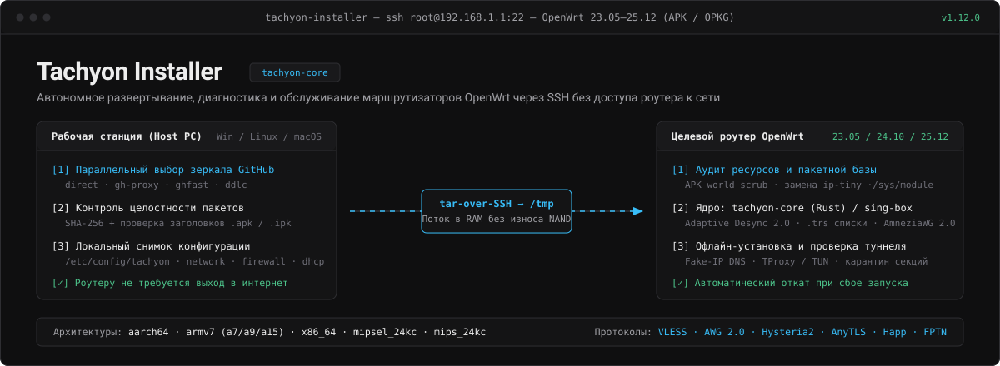
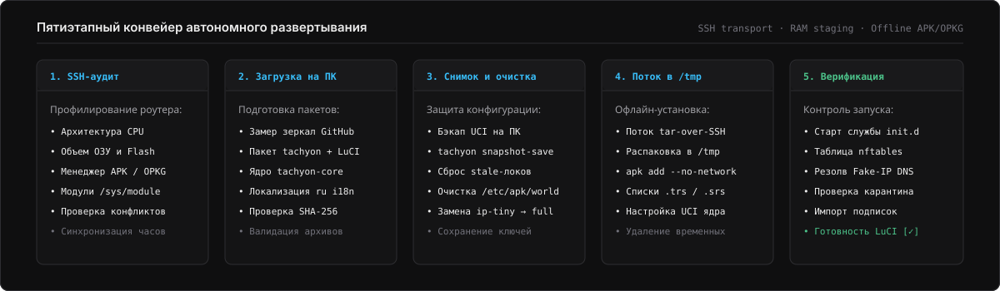

<div align="center">



[](https://go.dev/)
[](https://github.com/Dushnilin/tachyon-installer/releases)
[](https://github.com/Dushnilin/tachyon-installer/releases)
[](https://openwrt.org/)
[](https://t.me/tachyon_proxy)
[](LICENSE)

[**Русский**](README.md) · [**English**](README.en.md)

</div>

---

## Overview

**Tachyon Installer** is a standalone cross-platform utility (interactive TUI and headless CLI) for deploying, diagnosing, and maintaining the **[Tachyon](https://github.com/Dushnilin/tachyon)** (v1.8.0+) routing ecosystem on **OpenWrt** routers (23.05, 24.10, 25.12, and SNAPSHOT across both `opkg` and `apk`).

### Why a Host-Side Installer

Under restrictive network conditions or on fresh OpenWrt installations, the router often cannot reach GitHub directly, causing router-side `curl | sh` scripts to time out. **Tachyon Installer** moves package acquisition and verification to your workstation (Windows, Linux, macOS):

1. Benchmarks available GitHub mirrors in parallel and downloads `tachyon`, `luci-app-tachyon`, localization packages, `.trs`/`.srs` binary lists, and the selected routing engine onto your computer.
2. Verifies **SHA-256** checksums and package headers (`.apk` / `.ipk`) before touching the router.
3. Connects to the router over local SSH, profiles hardware and kernel modules, saves a configuration snapshot on the host PC, and streams packages directly into RAM (`/tmp` via `tar-over-SSH`) with zero NAND flash wear.

---

## Core Capabilities

- **Support for 1.8.x Stable & 2.0 Beta Releases (`-version beta`)**:
  - Supports both the stable branch (`latest` with `tachyon_*.apk`/`.ipk`, `luci-app-tachyon`, `sha256sums.txt`) and `2.0` branch pre-releases (`beta` or an explicit tag like `v2.0.0-beta.7` with single-bundle per-architecture `tachyon-<arch>-v<ver>.apk`/`.ipk`, `SHA256SUMS`, and embedded `:1680` panel).
  - The TUI shows both release channels (`latest` and `beta`); upgrading a `1.x` router to `2.0` automatically migrates and preserves `/etc/config/tachyon` in `/etc/tachyon/backup-pre-2.0/tachyon.uci`, cleans up legacy `ucode`/`rpcd` files, and disables the standalone `tachyon-core` init service.
- **Single Native `tachyon-core` Engine (Rust)**:
  - Starting with **Tachyon 1.8.0**, `tachyon-core` is the sole supported core (~4.2 MB RAM, zero GC pauses, built-in Adaptive Desync 2.0, AmneziaWG 2.0, VLESS/xHTTP/Reality, Hysteria2, TUIC, ShadowTLS, AnyTLS, CSQTT, WDTT/QWDTT v3, Mieru, embedded FPTN and Tailscale, IPv6/FakeIPv6 `fc00::/18`, Leak Guard, and binary `.trs` rule-sets).
  - When upgrading older installations, the installer removes legacy `sing-box` packages and migrates UCI settings to `engine='tachyon-core'` and `subscription_engine='core'`.
  - In-place core update (`-switch-engine tachyon-core` or hotkey `S`) upgrades `tachyon-core` without reinstalling LuCI or resetting subscriptions.
- **OpenWrt 25.12+ (APK) & 23.05–24.10 (OPKG) Compatibility**:
  - Offline local `.apk` and `.ipk` installation (including native `tachyon-core-*.apk`/`.ipk` packages) with virtual package fallback for pinned APK world constraints.
  - Automatic `/etc/apk/world` cleanup of legacy conflicting packages (`forkop`, `podkop`, `netshift`), stale init lock cleanup (`flock 1000`, `99-tachyon-wan`), and `ip-tiny` ↔ `ip-full` conflict resolution.
  - Kernel module verification via `/sys/module/` (`nft_tproxy`, `nft_fib_inet`, `tun`, `inet_diag`, `netlink_diag`, `nft_nat`, `tcp_bbr`) and best-effort TCP BBR sysctl setup (`/etc/sysctl.d/99-tachyon-bbr.conf`).
- **Guided Setup (`-wizard` / hotkey `A`)**:
  - Tests ISP UDP 53 DNS spoofing/poisoning and benchmarks clean DoH resolvers.
  - Evaluates packet desynchronization profiles: native **Tachyon Adaptive Desync 2.0** (`adaptive`, `fake_split`, `fake_disorder`, `multi_split` + UDP QUIC Fake) on `tachyon-core`, or `zapret2`/`nfqws2` profiles.
  - Tunes kernel network parameters and runs end-to-end reachability probes through the router.
- **AmneziaWG 2.0 & Cloudflare WARP (`-awg` / hotkey `W`)**:
  - Registers Cloudflare WARP keys directly from the router, or imports `.conf` files and `vpn://` containers.
  - Supports full AmneziaWG 2.0 CPS signature tags (`Jc`, `Jmin`, `Jmax`, `S1..S4`, `H1..H4`, `I1..I5`, `J1..J3`, `ITime`).
- **Universal Subscription Manager (`-sub`, `-test-sub`)**:
  - Supports HTTPS subscription URLs (`subscription_engine='core'`), `happ://crypt4/...`, `fptn:` / `fptnb:`, `vless://`, `vmess://`, `trojan://`, `ss://`, `hy2://`, `tuic://`, `anytls://`, `csqtt://`, `wdtt://`, `qwdtt://`, `awg://`, `mieru://`, `mierus://`, `openvpn://`, `tailscale://`, `snell://`, `sudoku://`, `masque://`, `trusttunnel://`, `naive+https://`, `tg://`, `mtproto://`, `warp://`, and multi-URI lines.
  - Concurrent TCP handshake latency benchmark across all parsed nodes.
- **Diagnostics, Speed Doctor & Emergency Rescue**:
  - **7-Point Diagnostics (`-diag` / `D`)**: inspects CPU architecture, RAM/Flash, kernel modules (`nft_tproxy`, `nft_fib`, `tun`, `tcp_bbr`), `nftables` chains, section quarantine state (`/var/run/tachyon/validator-quarantined.json`), DNS resolution, and conflicting services.
  - **Speed & Bufferbloat Doctor (`-speedtest` / `P`)**: measures WAN and tunnel throughput, loaded ping delta (A+..F grade), and CPU SoftIRQ saturation without writing to flash.
  - **Network Stack Tuning (`-tune-network` / `T`)**: enables TCP BBR + `fq_codel`, scales socket buffers (`rmem`/`wmem`) to router RAM, tunes `conntrack` timeouts, and disables incompatible `fw4` Flow Offloading so TProxy/nftables rules are not skipped by hardware offload.
  - **Emergency Rescue (`-rescue` / `R`)**: flushes `TachyonTable`, `TachyonKillSwitch` (fail-closed), and `tachyon_tailscale` tables, cleans policy routing (`fwmark`, tables `tachyon`/`105`/`100`/`4247`/`4248`, netns `fkpsc`), restores `dnsmasq` backups, and recovers direct WAN connectivity.
- **Multi-Router Fleet Manager (`-fleet-scan`, `-fleet-deploy` / hotkey `F`)**:
  - Scans local CIDR subnets for OpenWrt routers, builds a hardware/version inventory, and deploys or updates Tachyon concurrently.

---

## Deployment Pipeline

<div align="center">



</div>

1. **SSH Router Audit**: detects router model, OpenWrt release, target architecture (`aarch64`, `armv7`, `armv6`, `x86_64`, `mipsel`, `mips`, `riscv64`, `i386_pentium4`), package manager (`apk` / `opkg`), free RAM/Flash, and synchronizes router UTC clock with the host PC.
2. **Host-Side Package Acquisition**: benchmarks GitHub mirrors (`gh-proxy.com`, `ghfast.top`, `gh.ddlc.top`, `gh-proxy.org`, `direct`), downloads Tachyon packages, `.trs`/`.srs` rule-sets (`Dushnilin/tachyon-lists`), and engine binaries, and verifies SHA-256 checksums.
3. **Snapshot & World Scrub**: backs up `/etc/config/tachyon` and `/etc/tachyon` to the host PC, triggers `tachyon snapshot-save`, clears stale locks, and scrubs `/etc/apk/world`.
4. **RAM Streaming (`tar-over-SSH`)**: streams packages into `/tmp`, performs offline installation, and configures UCI (`engine='tachyon-core'`, `subscription_engine='core'`).
5. **Verification**: verifies service startup, `nftables` tables, Fake-IP DNS resolution, and section quarantine status, automatically rolling back on critical failure.

---

## Quick Start

### One-Line Launch

Detects your workstation OS and architecture (`amd64` / `arm64`), downloads the latest standalone binary via the fastest available mirror, and starts the interface:

**Windows (PowerShell):**
```powershell
irm https://raw.githubusercontent.com/Dushnilin/tachyon-installer/main/install.ps1 | iex
```
*(Mirror fallback:* `irm https://gh-proxy.com/https://raw.githubusercontent.com/Dushnilin/tachyon-installer/main/install.ps1 | iex`*)*

**Linux & macOS:**
```bash
curl -fsSL https://raw.githubusercontent.com/Dushnilin/tachyon-installer/main/install.sh | bash
```
*(Mirror fallback:* `curl -fsSL https://gh-proxy.com/https://raw.githubusercontent.com/Dushnilin/tachyon-installer/main/install.sh | bash`*)*

---

### Pre-Built Binaries

Standalone zero-dependency binaries are available on **[GitHub Releases](https://github.com/Dushnilin/tachyon-installer/releases)**:

| Operating System | Architecture | Binary |
| :--- | :--- | :--- |
| **Windows** | x86_64 (amd64) | `tachyon-installer-windows-amd64.exe` |
| **Windows** | ARM64 | `tachyon-installer-windows-arm64.exe` |
| **Linux** | x86_64 (amd64) | `tachyon-installer-linux-amd64` |
| **Linux** | ARM64 (aarch64) | `tachyon-installer-linux-arm64` |
| **macOS** | Apple Silicon (M1–M4) | `tachyon-installer-darwin-arm64` |
| **macOS** | Intel (x86_64) | `tachyon-installer-darwin-amd64` |

### Interactive TUI

Run `./tachyon-installer` (or `.\tachyon-installer.exe` on Windows) with no flags:

- `Tab` / `↑` `↓` — navigate fields and sections;
- `←` `→` or keys `1`–`2` — select core deployment mode (`tachyon-core` / skip), version, and mirror on the options screen;
- `Space` — toggle options (`luci-i18n-tachyon-ru`, `zram-swap`);
- Global shortcuts on the welcome and options screens:
  - `A` — guided setup wizard (DNS + Adaptive Desync 2.0 + network tuning);
  - `W` — AmneziaWG 2.0 / Cloudflare WARP setup;
  - `P` — WAN/tunnel speed & Bufferbloat test;
  - `F` — multi-router fleet discovery and batch deployment;
  - `S` — update or redeploy `tachyon-core` without reinstalling LuCI;
  - `D` — 7-point router diagnostics;
  - `M` — live CPU/RAM/conntrack monitor;
  - `T` — kernel network stack tuning (`sysctl` + BBR);
  - `C` — disable conflicting proxy services (`passwall`, `openclash`, `zapret`, etc.);
  - `B` — create full configuration snapshot;
  - `R` — emergency network rescue.

---

### Headless CLI Automation

```bash
# Express installation of the latest stable release with tachyon-core and zRAM-swap
./tachyon-installer -ip 192.168.1.1 -pass "secret" -engine tachyon-core -zram -yes

# Install the latest 2.0 beta pre-release or an explicit beta tag
./tachyon-installer -ip 192.168.1.1 -pass "secret" -version beta -yes
./tachyon-installer -ip 192.168.1.1 -pass "secret" -version v2.0.0-beta.7 -yes

# Express installation with immediate subscription import (HTTPS, vless://, happ://crypt4/..., fptn:)
./tachyon-installer -ip 192.168.1.1 -pass "secret" -sub "https://example.com/sub" -yes

# Hot-swap routing engine to tachyon-core without reinstalling LuCI
./tachyon-installer -ip 192.168.1.1 -pass "secret" -switch-engine tachyon-core

# Guided setup (DNS poisoning check, Adaptive Desync selection, BBR tuning)
./tachyon-installer -ip 192.168.1.1 -pass "secret" -wizard

# Configure and verify an AmneziaWG 2.0 section (Cloudflare WARP, .conf file, or vpn://)
./tachyon-installer -ip 192.168.1.1 -pass "secret" -awg -awg-conf warp -awg-section warp

# Run WAN/tunnel throughput, Bufferbloat, and CPU SoftIRQ test
./tachyon-installer -ip 192.168.1.1 -pass "secret" -speedtest -speed-duration 5

# Optimize kernel network stack (TCP BBR, fq_codel, socket buffers, disable flow offloading)
./tachyon-installer -ip 192.168.1.1 -pass "secret" -tune-network

# Check installed Tachyon/engine versions on the router against latest GitHub release
./tachyon-installer -ip 192.168.1.1 -pass "secret" -check-router

# Run router diagnostics and export report to file
./tachyon-installer -ip 192.168.1.1 -pass "secret" -diag -export-diag report.txt

# Scan subnet and deploy updates to outdated routers
./tachyon-installer -fleet-scan -fleet-subnets "192.168.1.0/24"
./tachyon-installer -pass "secret" -fleet-deploy -fleet-only-outdated

# Benchmark TCP latency across subscription nodes from host PC
./tachyon-installer -test-sub "https://example.com/sub"

# Download complete offline package bundle for air-gapped deployments
./tachyon-installer -offline-bundle "offline_pkg/"

# Emergency rescue: flush interception rules and restore direct internet
./tachyon-installer -ip 192.168.1.1 -pass "secret" -rescue

# Create full system snapshot or restore from latest local backup
./tachyon-installer -ip 192.168.1.1 -pass "secret" -snapshot
./tachyon-installer -ip 192.168.1.1 -pass "secret" -restore latest

# Cleanly uninstall Tachyon from the router
./tachyon-installer -ip 192.168.1.1 -pass "secret" -uninstall
```

---

## Building From Source

Requires **Go 1.22+**:

```bash
git clone https://github.com/Dushnilin/tachyon-installer.git
cd tachyon-installer

# Build for current host OS/architecture
go build -o tachyon-installer .

# Cross-compile all 6 desktop targets (windows/linux/darwin, amd64 + arm64) into dist/
go run scripts/build.go -v 1.14.0
```

---

## License & Links

Licensed under the **GNU General Public License v3.0 (GPL-3.0)**.

- Core Router & LuCI Repository: **[Dushnilin/tachyon](https://github.com/Dushnilin/tachyon)**
- Updates & Community: **[Telegram — Tachyon](https://t.me/tachyon_proxy)**
