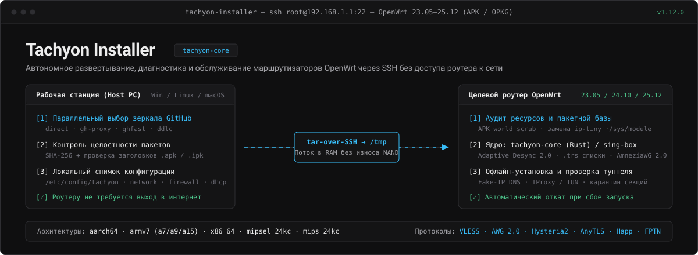
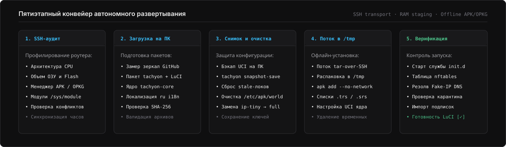

<div align="center">



[](https://go.dev/)
[](https://github.com/Dushnilin/tachyon-installer/releases)
[](https://github.com/Dushnilin/tachyon-installer/releases)
[](https://openwrt.org/)
[](https://t.me/tachyon_proxy)
[](LICENSE)

[**Русский**](README.md) · [**English**](README.en.md)

</div>

---

## О проекте

**Tachyon Installer** — автономная кроссплатформенная утилита (TUI и CLI) для установки, диагностики и обслуживания экосистемы **[Tachyon](https://github.com/Dushnilin/tachyon)** (v1.8.0+) на маршрутизаторах под управлением **OpenWrt** (23.05, 24.10, 25.12 и SNAPSHOT с пакетными менеджерами `opkg` и `apk`).

### Зачем нужен отдельный установщик

При сетевых ограничениях или на чистой прошивке маршрутизатор часто не имеет стабильного доступа к GitHub, из-за чего запуск `curl | sh` на самом роутере обрывается. **Tachyon Installer** переносит сетевую и подготовительную нагрузку на рабочую станцию администратора (Windows, Linux, macOS):

1. Рабочая станция параллельно измеряет отклик зеркал GitHub и скачивает пакеты `tachyon`, `luci-app-tachyon`, локализацию и выбранное ядро.
2. Локально проверяет контрольные суммы **SHA-256** и структуру пакетов (`.apk` / `.ipk`).
3. По SSH подключается к роутеру в локальной сети, выполняет аудит ресурсов, сохраняет резервную копию конфигурации на ПК и потоком (`tar-over-SSH`) передает пакеты в оперативную память (`/tmp`), не расходуя ресурс флеш-памяти NAND.

---

## Ключевые возможности

- **Поддержка релизов 1.8.x и бета-сборок ветки 2.0 (`-version beta`)**:
  - Поддерживается как стабильная ветка (`latest`, пакеты `tachyon_*.apk`/`.ipk`, `luci-app-tachyon`, `sha256sums.txt`), так и бета-релизы ветки `2.0` (`beta` или конкретный тег, например `v2.0.0-beta.7`: единый архитектурный пакет `tachyon-<arch>-v<ver>.apk`/`.ipk`, `SHA256SUMS`, встроенная панель `:1680`).
  - В TUI отображаются оба канала (`latest` и `beta`), а при обновлении с `1.x` на `2.0` выполняется автоматическая миграция с сохранением `/etc/config/tachyon` в `/etc/tachyon/backup-pre-2.0/tachyon.uci`, очисткой legacy-файлов `ucode`/`rpcd` и отключением отдельного init-сервиса `tachyon-core`.
- **Единое нативное ядро `tachyon-core` (Rust)**:
  - Начиная с **Tachyon 1.8.0**, единственным поддерживаемым ядром является `tachyon-core` (~4.2 МБ ОЗУ, без пауз GC, встроенные Adaptive Desync 2.0, AmneziaWG 2.0, VLESS/xHTTP/Reality, Hysteria2, TUIC, ShadowTLS, AnyTLS, CSQTT, WDTT/QWDTT v3, Mieru, встроенные FPTN и Tailscale, IPv6/FakeIPv6 `fc00::/18`, Leak Guard и бинарные списки `.trs`).
  - При обновлении роутера со старых конфигураций установщик автоматически удаляет устаревшие пакеты `sing-box` и мигрирует профиль на `engine='tachyon-core'` и `subscription_engine='core'`.
  - Быстрое обновление ядра (`-switch-engine tachyon-core` или клавиша `S`) без переустановки LuCI и без потери подписок.
- **Полная совместимость с OpenWrt 25.12+ (APK) и 23.05–24.10 (OPKG)**:
  - Офлайн-установка локальных `.apk` и `.ipk` пакетов (включая нативные пакеты `tachyon-core-*.apk`/`.ipk`) с fallback на виртуальный пакет при жестких hash-привязках `apk`.
  - Автоматическая очистка `/etc/apk/world` от устаревших зависимостей (`forkop`, `podkop`, `netshift`), удаление stale lock-файлов (`flock 1000`, `99-tachyon-wan`) и разрешение конфликта `ip-tiny` ↔ `ip-full`.
  - Проверка модулей ядра (`nft_tproxy`, `nft_fib_inet`, `tun`, `inet_diag`, `netlink_diag`, `nft_nat`, `tcp_bbr`) через `/sys/module/` и best-effort активация TCP BBR (`/etc/sysctl.d/99-tachyon-bbr.conf`).
- **Мастер быстрой настройки (`-wizard` / клавиша `A`)**:
  - Проверка DNS провайдера на перехват/спуфинг UDP 53 и выбор самого быстрого DoH-резолвера.
  - Подбор стратегии пакетной десинхронизации: нативный **Tachyon Adaptive Desync 2.0** (`adaptive`, `fake_split`, `fake_disorder`, `multi_split` + UDP QUIC Fake) на ядре `tachyon-core` либо профили `zapret2`/`nfqws2`.
  - Настройка сетевого стека и проверка доступности целевых ресурсов через роутер.
- **AmneziaWG 2.0 и Cloudflare WARP (`-awg` / клавиша `W`)**:
  - Автоматическая регистрация аккаунта Cloudflare WARP прямо с роутера, импорт `.conf` файлов и контейнеров `vpn://`.
  - Поддержка расширенных параметров обфускации AmneziaWG 2.0: `Jc`, `Jmin`, `Jmax`, `S1..S4`, `H1..H4`, сигнатур `I1..I5`, `J1..J3` и `ITime`.
- **Универсальный менеджер подписок (`-sub`, `-test-sub`)**:
  - Поддержка HTTPS-подписок (`subscription_engine='core'`), контейнеров `happ://crypt4/...`, `fptn:` / `fptnb:`, `vless://`, `vmess://`, `trojan://`, `ss://`, `hy2://`, `tuic://`, `anytls://`, `csqtt://`, `wdtt://`, `qwdtt://`, `awg://`, `mieru://`, `mierus://`, `openvpn://`, `tailscale://`, `snell://`, `sudoku://`, `masque://`, `trusttunnel://`, `naive+https://`, `tg://`, `mtproto://`, `warp://` и многострочных списков ссылок.
  - Параллельный замер TCP-задержки до всех узлов подписки.
- **Инструменты диагностики и восстановления**:
  - **7-точечная диагностика (`-diag` / `D`)**: проверка архитектуры, памяти, модулей ядра (`nft_tproxy`, `nft_fib`, `tun`, `tcp_bbr`), таблиц `nftables`, карантина сбойных секций (`/var/run/tachyon/validator-quarantined.json`), DNS и конфликтов.
  - **Тест скорости и Bufferbloat (`-speedtest` / `P`)**: потоковый замер скорости WAN и туннеля, оценка задержки под нагрузкой (грейд A+..F) и контроль перегрузки CPU SoftIRQ.
  - **Тюнинг сетевого стека (`-tune-network` / `T`)**: включение TCP BBR + `fq_codel`, расчет буферов `rmem`/`wmem` по объему ОЗУ, оптимизация таймаутов `conntrack` и отключение несовместимого с TProxy `Flow Offloading` в `fw4`.
  - **Аварийный сброс (`-rescue` / `R`)**: удаление таблиц `TachyonTable`, `TachyonKillSwitch` (fail-closed) и `tachyon_tailscale`, очистка policy routing (`fwmark`, таблиц `tachyon`/`105`/`100`/`4247`/`4248`, netns `fkpsc`), восстановление `dnsmasq` из бэкапа и возврат прямого доступа в интернет.
- **Управление флотом роутеров (`-fleet-scan`, `-fleet-deploy` / клавиша `F`)**:
  - Сканирование заданных подсетей, сбор инвентаря моделей и версий Tachyon, параллельное развертывание и обновление в несколько потоков.

---

## Архитектура и конвейер установки

<div align="center">



</div>

1. **SSH-аудит роутера**: определение модели, версии OpenWrt, архитектуры (`aarch64`, `armv7`, `armv6`, `x86_64`, `mipsel`, `mips`, `riscv64`, `i386_pentium4`), пакетного менеджера (`apk` / `opkg`), свободного места и конфликтов, синхронизация системных часов с ПК.
2. **Загрузка пакетов на ПК**: параллельный тест зеркал GitHub (`gh-proxy.com`, `ghfast.top`, `gh.ddlc.top`, `gh-proxy.org`, `direct`), скачивание релиза Tachyon, бинарных списков `.trs`/`.srs` (`Dushnilin/tachyon-lists`) и ядра, сверка SHA-256.
3. **Снимок и подготовка базы**: сохранение `/etc/config/tachyon` и `/etc/tachyon` на ПК, вызов `tachyon snapshot-save`, очистка зависших lock-файлов и исправление `/etc/apk/world`.
4. **Потоковая передача в `/tmp`**: загрузка пакетов через `tar-over-SSH` в RAM (`tmpfs`), офлайн-установка и настройка UCI (`engine='tachyon-core'`, `subscription_engine='core'`).
5. **Верификация и запуск**: проверка старта службы, правил `nftables`, резолвинга Fake-IP DNS и карантина секций; при критическом сбое — автоматический откат.

---

## Быстрый старт

### Запуск одной командой

Скрипт определяет ОС и архитектуру рабочей станции (`amd64` / `arm64`), скачивает актуальный бинарный файл через доступное зеркало и запускает интерфейс:

**Windows (PowerShell):**
```powershell
irm https://raw.githubusercontent.com/Dushnilin/tachyon-installer/main/install.ps1 | iex
```
*(Через зеркало:* `irm https://gh-proxy.com/https://raw.githubusercontent.com/Dushnilin/tachyon-installer/main/install.ps1 | iex`*)*

**Linux и macOS:**
```bash
curl -fsSL https://raw.githubusercontent.com/Dushnilin/tachyon-installer/main/install.sh | bash
```
*(Через зеркало:* `curl -fsSL https://gh-proxy.com/https://raw.githubusercontent.com/Dushnilin/tachyon-installer/main/install.sh | bash`*)*

---

### Ручная загрузка сборок

Готовые исполняемые файлы без внешних зависимостей доступны в разделе **[Releases](https://github.com/Dushnilin/tachyon-installer/releases)**:

| Операционная система | Архитектура | Исполняемый файл |
| :--- | :--- | :--- |
| **Windows** | x86_64 (amd64) | `tachyon-installer-windows-amd64.exe` |
| **Windows** | ARM64 | `tachyon-installer-windows-arm64.exe` |
| **Linux** | x86_64 (amd64) | `tachyon-installer-linux-amd64` |
| **Linux** | ARM64 (aarch64) | `tachyon-installer-linux-arm64` |
| **macOS** | Apple Silicon (M1–M4) | `tachyon-installer-darwin-arm64` |
| **macOS** | Intel (x86_64) | `tachyon-installer-darwin-amd64` |

### Интерактивный режим (TUI)

Запустите `./tachyon-installer` (или `.\tachyon-installer.exe` на Windows) без флагов:

- `Tab` / `↑` `↓` — перемещение между полями и разделами;
- `←` `→` или клавиши `1`–`2` — выбор режима установки ядра (`tachyon-core` / пропуск), версии и зеркала на экране параметров;
- `Space` — переключение флагов (`luci-i18n-tachyon-ru`, `zram-swap`);
- Горячие клавиши на стартовом экране и дашборде:
  - `A` — мастер быстрой настройки (DNS + Adaptive Desync 2.0 + сетевой тюнинг);
  - `W` — настройка AmneziaWG 2.0 / Cloudflare WARP;
  - `P` — тест скорости WAN/туннеля и Bufferbloat;
  - `F` — сканирование и пакетное обновление флота роутеров;
  - `S` — обновление или повторное развертывание `tachyon-core` без переустановки LuCI;
  - `D` — диагностика роутера;
  - `M` — мониторинг нагрузки CPU/RAM/сессий в реальном времени;
  - `T` — оптимизация сетевого стека (`sysctl` + BBR);
  - `C` — отключение конфликтующих служб (`passwall`, `openclash`, `zapret` и др.);
  - `B` — создание полного архива конфигурации;
  - `R` — аварийный сброс сетевых правил (Rescue).

---

### Неинтерактивный режим (Headless CLI)

```bash
# Экспресс-установка стабильной версии с ядром tachyon-core и включением zRAM-swap
./tachyon-installer -ip 192.168.1.1 -pass "secret" -engine tachyon-core -zram -yes

# Установка актуальной бета-сборки с ветки 2.0 (pre-release) или точного тега
./tachyon-installer -ip 192.168.1.1 -pass "secret" -version beta -yes
./tachyon-installer -ip 192.168.1.1 -pass "secret" -version v2.0.0-beta.7 -yes

# Установка с одновременным импортом подписки (HTTPS, vless://, happ://crypt4/..., fptn:)
./tachyon-installer -ip 192.168.1.1 -pass "secret" -sub "https://example.com/sub" -yes

# Горячая смена ядра на tachyon-core без переустановки LuCI
./tachyon-installer -ip 192.168.1.1 -pass "secret" -switch-engine tachyon-core

# Мастер автоматической настройки (проверка DNS, подбор стратегии Desync, BBR)
./tachyon-installer -ip 192.168.1.1 -pass "secret" -wizard

# Настройка и проверка секции AmneziaWG 2.0 (Cloudflare WARP, .conf или vpn://)
./tachyon-installer -ip 192.168.1.1 -pass "secret" -awg -awg-conf warp -awg-section warp

# Тест скорости WAN/туннеля, Bufferbloat и нагрузки CPU
./tachyon-installer -ip 192.168.1.1 -pass "secret" -speedtest -speed-duration 5

# Оптимизация сетевого стека (TCP BBR, fq_codel, буферы сокетов, отключение flow offloading)
./tachyon-installer -ip 192.168.1.1 -pass "secret" -tune-network

# Проверка установленных версий на роутере и наличия обновлений
./tachyon-installer -ip 192.168.1.1 -pass "secret" -check-router

# Диагностика роутера с сохранением отчета в файл
./tachyon-installer -ip 192.168.1.1 -pass "secret" -diag -export-diag report.txt

# Сканирование подсети и пакетное обновление устаревших роутеров
./tachyon-installer -fleet-scan -fleet-subnets "192.168.1.0/24"
./tachyon-installer -pass "secret" -fleet-deploy -fleet-only-outdated

# Тестирование задержки узлов подписки с компьютера
./tachyon-installer -test-sub "https://example.com/sub"

# Сборка полного офлайн-комплекта пакетов для изолированных сетей
./tachyon-installer -offline-bundle "offline_pkg/"

# Аварийный сброс перехвата трафика и восстановление прямого интернета
./tachyon-installer -ip 192.168.1.1 -pass "secret" -rescue

# Создание полного снимка конфигурации и откат из архива
./tachyon-installer -ip 192.168.1.1 -pass "secret" -snapshot
./tachyon-installer -ip 192.168.1.1 -pass "secret" -restore latest

# Полное удаление Tachyon с роутера
./tachyon-installer -ip 192.168.1.1 -pass "secret" -uninstall
```

---

## Сборка из исходного кода

Требуется **Go 1.22+**:

```bash
git clone https://github.com/Dushnilin/tachyon-installer.git
cd tachyon-installer

# Сборка под текущую платформу
go build -o tachyon-installer .

# Кросс-компиляция всех 6 десктопных целей (windows/linux/darwin, amd64 + arm64) в dist/
go run scripts/build.go -v 1.14.0
```

---

## Лицензия и ссылки

Проект распространяется на условиях лицензии **GNU General Public License v3.0 (GPL-3.0)**.

- Основной репозиторий маршрутизатора и LuCI: **[Dushnilin/tachyon](https://github.com/Dushnilin/tachyon)**
- Канал обновлений и обсуждение: **[Telegram — Tachyon](https://t.me/tachyon_proxy)**
